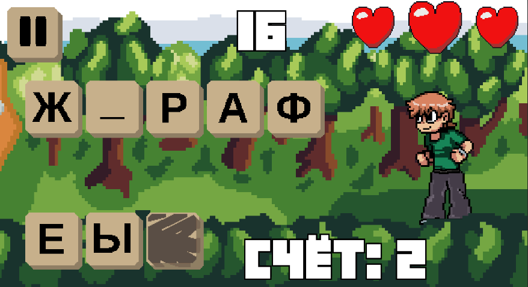
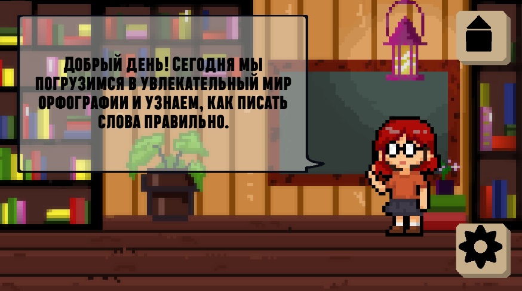
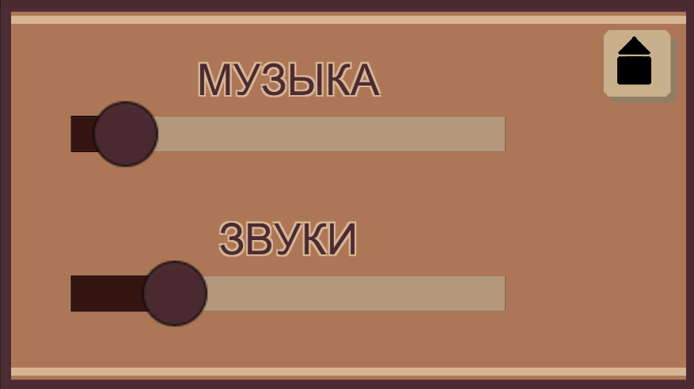
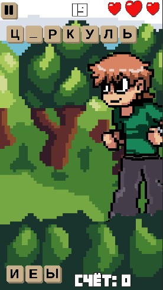

# No-Mistakes

**No-Mistakes** — обучающая игра на Unity и C#, разработанная для библиотеки с целью помочь детям изучать русский язык в интерактивном формате.

## Реализованные механики

- Генерация слов и букв на основе текстовых файлов.
- Выбор букв и проверка правильности ответов.
- Механика загрязнения и очистки букв.
- Система очков и здоровья игрока.
- Таймер игрового процесса.
- Постепенное увеличение сложности.
- Обработка игровых событий, включая правильные и неправильные ответы.
- Анимации игровых объектов и взаимодействий.
- Обучающий режим с пошаговыми сценариями.
- Настройки громкости музыки и звуковых эффектов.
- Сохранение пользовательских настроек.

## Адаптивный интерфейс

- Использование **Canvas Scaler** для масштабирования интерфейса.
- Использование **Anchors** для адаптивного позиционирования UI-элементов.
- Поддержка разных разрешений и соотношений сторон экрана.
- Поддержка горизонтальной и вертикальной ориентации экрана.

## Технологии

- **Unity** — игровой движок.
- **C#** — реализация игровой логики.
- **Unity UI** — создание пользовательского интерфейса.
- **ScriptableObject** — хранение игровых данных.
- **Coroutines** — управление временными игровыми процессами.
- **Animator** — анимация игровых объектов.
- **PlayerPrefs** — сохранение пользовательских настроек.

## Платформа

- **Android** — сборка APK проверена на устройствах.

## Скриншоты

### Игровой процесс



### Обучающий режим



### Настройки



### Мобильная версия



## Запуск проекта

1. Клонировать репозиторий:

   ```bash
   git clone https://github.com/Kirliffilan/No-mistakes.git
   ```

2. Открыть проект в Unity.
3. Открыть основную игровую сцену.
4. Запустить игру через Unity Editor.

Версию Unity можно посмотреть в файле `ProjectSettings/ProjectVersion.txt`.

## О проекте

Проект разработан в рамках учебной деятельности. В процессе разработки реализованы игровые механики, обработка событий, взаимодействие объектов, анимации, пользовательские настройки и адаптивный интерфейс. Отдельное внимание уделено поддержке мобильных устройств и корректному отображению интерфейса при различных разрешениях экрана.
